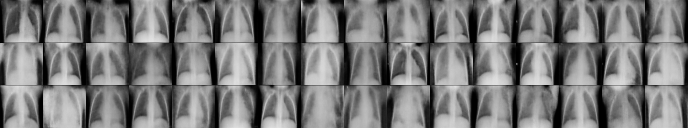
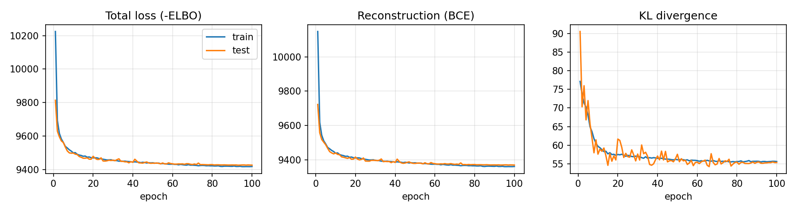

# ECE 285 HW1 - VAE on Chest X-rays

Convolutional VAE trained on the [chest X-ray pneumonia dataset](https://www.kaggle.com/paultimothymooney/chest-xray-pneumonia) to generate 128x128 chest X-rays. FID and IS are computed with pytorch-ignite following [this blog post](https://pytorch-ignite.ai/blog/gan-evaluation-with-fid-and-is/).

## Files
- `vae.py` - model, loss and data loading
- `train.py` - trains the VAE, saves loss curves and samples to `results/`
- `evaluate.py` - FID / IS of generated samples
- `results/` - loss curves, generated images, metrics and training log

## Running
Download the dataset from Kaggle and unzip it so the folders are `data/chest_xray/train` and `data/chest_xray/test`.

```
pip install torch torchvision pytorch-ignite scipy matplotlib
python train.py
python evaluate.py
```

Training takes about 4 minutes on an RTX 4060 laptop GPU.

## Results
| | FID | IS |
|---|---|---|
| VAE samples | 0.178 | 1.93 |
| VAE reconstructions | 0.212 | 1.99 |
| Real test images | 0.009 | 2.29 |



