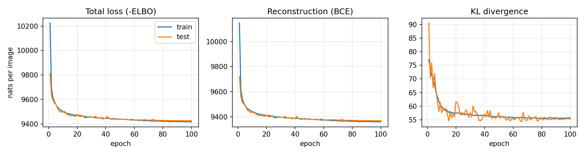

# ECE 285 HW1 - VAE on Chest X-rays

Convolutional VAE trained on the [chest X-ray pneumonia dataset](https://www.kaggle.com/paultimothymooney/chest-xray-pneumonia) to generate 128x128 chest X-rays. FID and IS are computed with pytorch-ignite following [this blog post](https://pytorch-ignite.ai/blog/gan-evaluation-with-fid-and-is/).

## Files
- `vae.py` - model, loss and data loading
- `train.py` - trains the VAE, saves loss curves and samples to `results/`
- `evaluate.py` - FID / IS of generated samples
- `results/` - loss curves, generated images, metrics and training log

## Running
Download the dataset from Kaggle and unzip it so the folders are `data/chest_xray/train` and `data/chest_xray/test`.

```
pip install torch torchvision pytorch-ignite scipy matplotlib
python train.py
python evaluate.py
```

Training takes about 4 minutes on an RTX 4060 laptop GPU.

## Results
| | FID | IS |
|---|---|---|
| VAE samples | 0.178 | 1.93 |
| VAE reconstructions | 0.212 | 1.99 |
| Real test images | 0.009 | 2.29 |

### Effect of beta
Same setup, only the KL weight changes. BCE and KL are in nats per test image (summed over the 128x128 pixels). Since the pixels are gray and not binary, the BCE can't go below the pixel entropy, which is about 9229 nats on the test set, so that is the floor and not 0.

```
python train.py --beta 0.5 --out results/beta_0.5
python evaluate.py --out results/beta_0.5
```

| beta | BCE | KL | FID | IS |
|---|---|---|---|---|
| 0.5 | 9353 | 83.7 | 0.162 | 2.20 |
| 1 | 9370 | 55.4 | 0.178 | 1.93 |
| 2 | 9398 | 36.4 | 0.193 | 1.84 |
| 4 | 9433 | 23.7 | 0.223 | 1.77 |

Samples for beta = 1:



