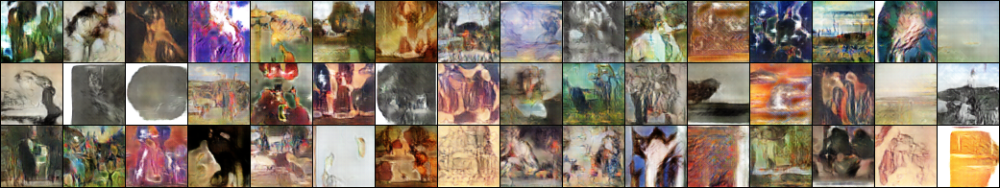
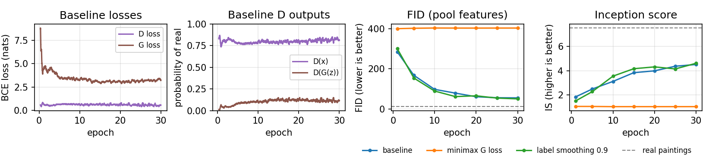

# ECE 285 HW2 - DCGAN on WikiArt

DCGAN trained on the [WikiArt dataset](https://www.kaggle.com/datasets/steubk/wikiart) (81,444 paintings, 27 styles) to generate 64x64 paintings. FID and IS are computed with pytorch-ignite following [this blog post](https://pytorch-ignite.ai/blog/gan-evaluation-with-fid-and-is/).

## Files
- `gan.py` - generator, discriminator and data loading
- `train.py` - trains the GAN, saves loss curves, samples and checkpoints every 5 epochs to `results/`
- `evaluate.py` - FID / IS of every saved checkpoint, plus real and noise reference sets
- `compare.py` - summary figure and table for the baseline and the two ablations
- `results/` - loss curves, generated images, metrics and logs

## Running
The dataset comes from `kaggle datasets download steubk/wikiart -p data`. `gan.py` reads the jpegs straight from `data/wikiart.zip` without extracting it and saves a 64x64 uint8 cache (1 GB) to `cache/` the first time.

```
pip install torch torchvision pytorch-ignite scipy matplotlib
python train.py
python evaluate.py
```

## Results
Scores after 30 epochs, 5,000 generated vs 5,000 real images. DCGAN is mean ± std over seeds 0, 1, 2.

| | FID | FID (pool) | IS |
|---|---|---|---|
| DCGAN | 0.067 | 54.2 ± 1.9 | 4.66 ± 0.13 |
| Real paintings | 0.015 | 11.7 | 7.51 |
| Uniform noise | 0.126 | 332.6 | 1.09 |

"FID" is exactly what the blog code gives. `FID()` with no arguments computes the distance on Inception's 1000-d softmax output, not on the 2048-d pool features of the usual FID, which is why the numbers are around 0.1. It also ranks uniform noise (0.126) above all three baseline seeds at epoch 1 and two of them at epoch 5. "FID (pool)" uses the 2048-d pool features of the same network, so it is the standard definition, but with torchvision weights instead of the TF Inception ones, so it is not directly comparable with published FIDs.

### Ablations
Same setup, one change each.

```
python train.py --g_loss minimax --out results/minimax
python train.py --real_label 0.9 --out results/smooth_0.9
python evaluate.py --out results/minimax
python evaluate.py --out results/smooth_0.9

# extra seeds for the baseline and label smoothing (same for seed 2)
python train.py --seed 1 --out results/seed1
python train.py --seed 1 --real_label 0.9 --out results/smooth_0.9_seed1
python evaluate.py --out results/seed1
python evaluate.py --out results/smooth_0.9_seed1

python compare.py
```

| run | seeds | FID | FID (pool) | IS |
|---|---|---|---|---|
| baseline (non-saturating G loss) | 0, 1, 2 | 0.067 | 54.2 ± 1.9 | 4.66 ± 0.13 |
| original minimax G loss | 0 | 0.152 | 403.6 | 1.05 |
| one-sided label smoothing (0.9) | 0, 1, 2 | 0.066 | 53.5 ± 2.6 | 4.41 ± 0.19 |

With the minimax loss, D wins in the first epoch (D(x) = 0.994, D(G(z)) = 0.000). After that G gets almost no gradient, its pool FID stays between 400 and 404 for all 30 epochs, and every sample is the same gray checkerboard (`results/minimax/samples_final.png`). Label smoothing lowers D(x) from about 0.8 to 0.73. Neither its pool FID (Welch t-test p = 0.73) nor its IS (p = 0.15) is significantly different from the baseline over three seeds. With seed 0 alone it looked 5 FID better (50.5 vs 55.5), which is why I ran the extra seeds.

Samples from the final generator (top) and real paintings (bottom):




